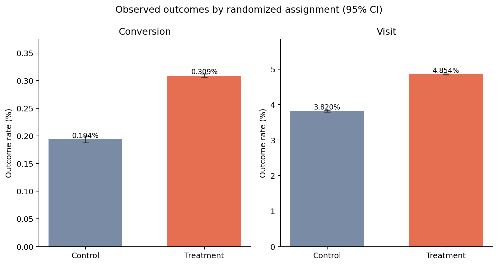
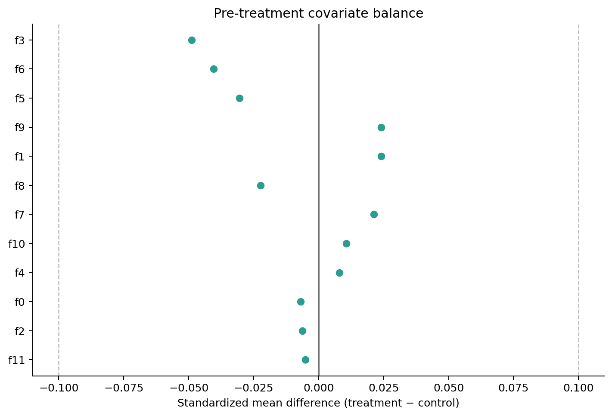

# Large-Scale Product Experimentation & Uplift Modeling

This portfolio project studies a randomized advertising experiment with nearly 14 million users. The first phase builds a reproducible DuckDB data pipeline and estimates intent-to-treat effects on conversion and visits. Later phases will add exploratory treatment-effect heterogeneity, an out-of-sample T-Learner, and policy evaluation.

> Project status: **Phase 1 implemented — data pipeline, experiment checks, and A/B testing.** Uplift modeling and targeting-policy results are intentionally not included yet.

## Business question

Does assignment to the advertising treatment increase visits and conversions, and is the estimated lift large enough to matter in practice?

The primary outcome is `conversion`; `visit` is a secondary outcome. The causal analysis uses randomized `treatment` assignment, not realized `exposure`. Exposure requires winning an ad auction and therefore should not be treated as if it were independently randomized.

## Dataset

The project uses the corrected **Criteo Uplift Prediction Dataset v2.1**:

- 13,979,592 users
- 12 anonymized features (`f0`–`f11`)
- randomized treatment assignment
- binary visit and conversion outcomes
- approximately 297 MB compressed

The raw data is excluded from Git. Review the [official Criteo dataset page](https://ailab.criteo.com/criteo-uplift-prediction-dataset/) and its CC BY-NC-SA 4.0 terms before downloading.

## Phase 1 scope

- Stream the compressed CSV from the official source and verify its expected columns
- Convert the 14M-row CSV to compressed Parquet with DuckDB
- Report row counts, missingness, treatment allocation, and covariate balance
- Estimate absolute lift, relative lift, risk ratio, 95% confidence intervals, and two-proportion z-tests
- Report Cohen's h and an approximate 80%-power minimum detectable effect (MDE)
- Save reproducible tables and figures for the final README

The treatment allocation ratio is reported but no sample-ratio-mismatch test is performed because the intended randomization probability is not published with the dataset.

## Phase 1 results

The pipeline successfully validated all 13,979,592 rows with no missing values or invalid binary indicators. All 12 pre-treatment features have absolute standardized mean differences below 0.05.

| Outcome | Control | Treatment | Absolute lift (95% CI) | Relative lift |
|---|---:|---:|---:|---:|
| Conversion | 0.194% | 0.309% | +0.115 pp [0.108, 0.122] | +59.4% |
| Visit | 3.820% | 4.854% | +1.034 pp [1.006, 1.063] | +27.1% |

Within this benchmark sample, assignment to treatment produced approximately 115 additional conversions and 1,034 additional visits per 100,000 users. These are precisely estimated intent-to-treat effects, not effects of realized exposure.





Because Criteo anonymized and prepared this dataset as a public uplift benchmark, these results support method comparison but should not be interpreted as production advertising ROI without treatment-cost and conversion-value information.

## Repository structure

```text
.
├── README.md
├── requirements.txt
├── data/
│   ├── README.md
│   ├── raw/
│   └── processed/
├── sql/
│   └── metrics.sql
├── src/
│   ├── data.py
│   └── experiment.py
├── notebooks/
│   └── README.md
├── figures/
└── reports/
    └── tables/
```

## Reproduce Phase 1

Run these commands from the repository root:

```bash
python -m venv .venv
source .venv/bin/activate
python -m pip install -r requirements.txt

# Download the official corrected dataset (about 300 MB compressed).
python src/data.py download

# Validate it and create data/processed/criteo_uplift.parquet.
python src/data.py prepare

# Run experiment checks and A/B tests.
python src/experiment.py
```

If the dataset has already been downloaded elsewhere:

```bash
python src/data.py prepare --input /absolute/path/to/criteo-uplift-v2.1.csv.gz
python src/experiment.py --data data/processed/criteo_uplift.parquet
```

Generated outputs:

- `data/processed/data_quality.json`
- `reports/tables/ab_test_results.csv`
- `reports/tables/experiment_arms.csv`
- `reports/tables/covariate_balance.csv`
- `reports/phase1_experiment_report.md`
- `figures/ab_test_effects.png`
- `figures/covariate_balance.png`

## Statistical notes

- Difference-in-proportions confidence intervals use an unpooled standard error.
- The null-hypothesis z-test uses the pooled proportion.
- Relative effects are accompanied by log-scale risk-ratio confidence intervals.
- MDE is a local normal approximation around the observed control rate, not post-hoc “observed power.”
- With millions of observations, practical magnitude and confidence intervals matter more than p-values alone.

## Planned next phase

The next phase will add only the agreed middle-scope components: pre-specified exploratory feature bins, a LightGBM T-Learner, honest test-set Qini/AUUC evaluation, and a small treat-all versus top-20%/top-30% policy comparison.

## Citation

```bibtex
@inproceedings{Diemert2018,
  author = {{Diemert Eustache, Betlei Artem} and Renaudin, Christophe and Massih-Reza, Amini},
  title = {A Large Scale Benchmark for Uplift Modeling},
  booktitle = {Proceedings of the AdKDD and TargetAd Workshop},
  year = {2018}
}
```
