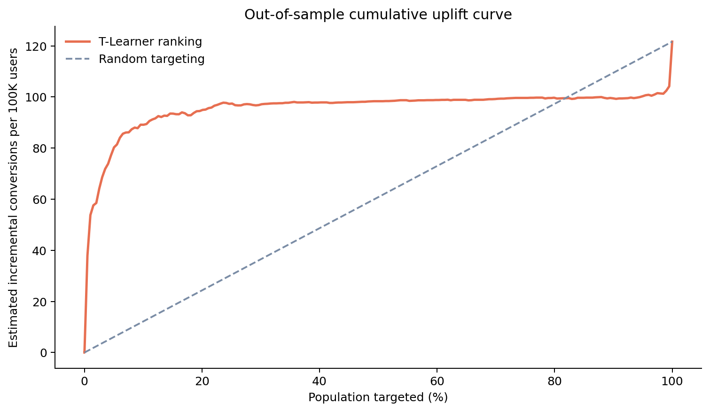
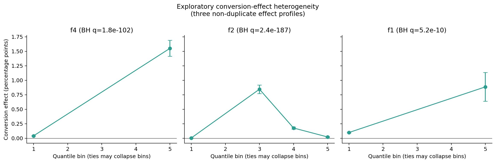
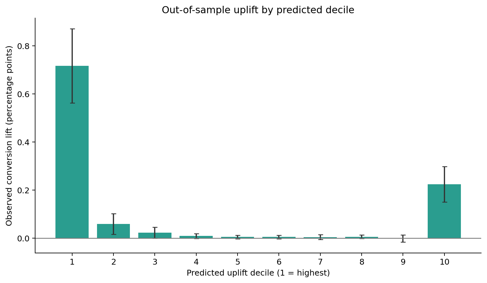

# Large-Scale Product Experimentation & Uplift Modeling

**Python · SQL · DuckDB · LightGBM · Double Machine Learning · 13.98M users**

## Executive summary

This project analyzes a large randomized advertising experiment and turns its average treatment effect into a targeting decision. Assignment to treatment increased conversion from **0.194% to 0.309%**—an absolute lift of **0.115 percentage points** (95% CI: 0.108–0.122 pp) and a relative lift of **59.4%**.

As a covariate-adjusted robustness analysis, three-fold cross-fitted Double Machine Learning estimated a conversion ATE of **0.0996 pp** (SE: 0.0034 pp; 95% CI: 0.0930–0.1062 pp). The estimate remains strongly positive but is 13.5% below the raw difference in means, so it is presented as a material sensitivity result—not as stronger causal identification in an already randomized experiment.

A LightGBM T-Learner then ranked users by predicted incremental response. On an untouched 2.10M-user test set, targeting the top 20% retained **70.1% of treat-all incremental conversions while treating 80% fewer users**. Under an illustrative `$100/conversion` and `$0.05/treatment` scenario, targeting the top 30% produced the highest estimated net value.

| Decision metric | Result |
|---|---:|
| Conversion lift | +0.115 pp (+59.4% relative) |
| Visit lift | +1.034 pp (+27.1% relative) |
| Cross-fitted DML conversion ATE | +0.0996 pp [0.0930, 0.1062] |
| Top-20% incremental conversions retained | 70.1% |
| Top-30% incremental conversions retained | 75.7% |
| Test-set Qini coefficient | 0.000348 |



## Business question

Does assignment to advertising treatment increase visits and conversions, and can treatment be concentrated among users with the highest incremental response?

The primary outcome is `conversion`; `visit` is secondary. All causal estimates use randomized `treatment` assignment. Realized `exposure` requires winning an advertising auction and is therefore not substituted for randomized assignment.

## Analysis design

| Layer | Implementation | Guardrail |
|---|---|---|
| Data engineering | DuckDB scans compressed CSV and writes ZSTD Parquet | Raw and processed data excluded from Git |
| Experiment validation | Missingness, binary-field validation, allocation, standardized mean differences | No sample-ratio-mismatch test without a published intended allocation ratio |
| A/B test | Absolute/relative lift, risk ratio, 95% CI, z-test, Cohen's h, MDE | Effect size reported alongside significance |
| DML robustness | Three-fold cross-fitted AIPW/orthogonal score | Covariate adjustment, not a claim to repair confounding |
| Heterogeneity | Quantile-bin effects and feature-level Cochran Q tests | Exploratory label; Benjamini–Hochberg correction; no invented personas |
| Uplift model | Separate LightGBM treatment/control response models | Deterministic 70/15/15 train/validation/test split |
| Policy evaluation | Uplift deciles, Qini/AUUC, top-20%/top-30% policies | All final metrics use the untouched test set |

## Dataset and experiment health

The project uses the corrected [Criteo Uplift Prediction Dataset v2.1](https://ailab.criteo.com/criteo-uplift-prediction-dataset/):

- 13,979,592 users and 12 anonymized features (`f0`–`f11`)
- randomized treatment assignment with binary visit and conversion outcomes
- 85.0% observed treatment share
- no missing values or invalid binary indicators
- all 12 pre-treatment features have absolute standardized mean differences below 0.05

The corrected file's expected SHA-256 is recorded in [`data/README.md`](data/README.md). The dataset is excluded from Git and remains subject to Criteo's CC BY-NC-SA 4.0 terms.

## Experiment results

| Outcome | Control | Treatment | Absolute lift (95% CI) | Relative lift | 80% MDE |
|---|---:|---:|---:|---:|---:|
| Conversion | 0.194% | 0.309% | +0.115 pp [0.108, 0.122] | +59.4% | 0.009 pp |
| Visit | 3.820% | 4.854% | +1.034 pp [1.006, 1.063] | +27.1% | 0.040 pp |

Within this benchmark sample, treatment assignment generated approximately 115 additional conversions and 1,034 additional visits per 100,000 users.


<details>
<summary>Covariate balance</summary>


</details>

## Double Machine Learning robustness analysis

A three-fold cross-fitted interactive-regression DML estimator complements the unadjusted experiment analysis. It uses standardized logistic regression for the propensity nuisance and separate LightGBM treatment/control outcome nuisances. Every observation is scored by models trained without its fold, and all 13,979,592 users contribute to the orthogonal augmented inverse-propensity score.

| Estimator | Conversion ATE | Standard error | 95% CI |
|---|---:|---:|---:|
| Randomized difference in means | 0.1152 pp | 0.0034 pp | [0.1085, 0.1219] pp |
| Cross-fitted DML | 0.0996 pp | 0.0034 pp | [0.0930, 0.1062] pp |

DML reduces the standard error by approximately 2.0%, but its point estimate is 0.0156 pp lower and the confidence intervals do not overlap. Both methods support a positive treatment effect, while the difference shows that covariate adjustment is a meaningful sensitivity analysis in this pooled benchmark. DML is not used here to claim improved causal identification: treatment assignment is already randomized.

Full specification and fold diagnostics are in [`reports/dml_report.md`](reports/dml_report.md).

## Exploratory heterogeneity

All 12 features were screened with global 20th/40th/60th/80th percentile cutpoints. Tied cutpoints were collapsed rather than forcing artificial groups. Ten features had estimable and statistically detectable conversion-effect heterogeneity after Benjamini–Hochberg correction; `f5` and `f11` did not produce enough distinct quantile bins for a heterogeneity test.

Because the features are anonymized, these findings indicate predictive structure but cannot support named customer personas or substantive feature interpretations.

<details>
<summary>Selected exploratory effect profiles</summary>



</details>

## Uplift model and targeting policy

The T-Learner uses up to two million training observations per randomized arm and up to 500,000 validation observations per arm. Sampling is deterministic and does not depend on outcomes; class weighting is not used, preserving the probability scale. Final evaluation uses all 2,097,078 test users.

| Policy | Coverage | Incremental conversions per 100K (95% CI) | Incremental lift retained | Illustrative net value per 100K |
|---|---:|---:|---:|---:|
| Treat none | 0% | 0.0 | 0% | $0 |
| Top 20% uplift | 20% | 85.3 [69.0, 100.8] | 70.1% | $7,526 |
| Top 30% uplift | 30% | 92.1 [76.3, 107.2] | 75.7% | $7,714 |
| Treat all | 100% | 121.6 [103.4, 139.1] | 100% | $7,164 |

Policy confidence intervals use a stratified bootstrap conditional on each fixed targeting rule. Net value is a sensitivity scenario—not observed revenue—and changes with the assumed conversion value and treatment cost.

<details>
<summary>Observed uplift by predicted decile</summary>



</details>

## Limitations

- Criteo anonymized and prepared the data as a public benchmark, so estimates should not be interpreted as production advertising ROI.
- Anonymous features prevent substantive segment descriptions and actionability assessment.
- The uplift ranking is not perfectly monotonic: the lowest predicted decile still has positive observed lift. Alternative learners or calibration should be evaluated before deployment.
- The policy-value calculation requires assumed economics and does not account for interference, drift, or operational constraints.
- This project estimates intent-to-treat effects; it does not claim a causal effect of realized exposure.
- The DML estimate is materially below the raw difference in means; both are reported rather than selecting the more favorable estimate.

## Repository structure

```text
.
├── README.md
├── LICENSE
├── Makefile
├── requirements.txt
├── requirements-lock.txt
├── data/
│   ├── README.md
│   ├── raw/                       # ignored
│   └── processed/                 # ignored
├── sql/
│   └── metrics.sql
├── src/
│   ├── data.py
│   ├── experiment.py
│   ├── dml.py
│   ├── heterogeneity.py
│   ├── evaluation.py
│   └── uplift.py
├── tests/
│   └── test_evaluation.py
├── models/
│   ├── t_learner_arm_0.txt
│   └── t_learner_arm_1.txt
├── figures/
└── reports/
    ├── phase1_experiment_report.md
    ├── dml_report.md
    ├── phase2_heterogeneity_report.md
    ├── phase2_uplift_report.md
    └── tables/
```

## Reproduce

Tested with Python 3.13.7. Top-level dependencies are declared in `requirements.txt`, while `requirements-lock.txt` records the exact tested environment. Raw data and derived Parquet files are intentionally excluded from Git.

```bash
git clone https://github.com/Rita-zrFu/criteo-experimentation-uplift.git
cd criteo-experimentation-uplift

make setup
make download
make all
make test
```

Equivalent commands without `make`:

```bash
python3 -m venv .venv
source .venv/bin/activate
python -m pip install -r requirements-lock.txt
python src/data.py download
python src/data.py prepare
python src/experiment.py
python src/dml.py
python src/heterogeneity.py
python src/uplift.py
python -m unittest discover -s tests -v
```

The pipeline writes machine-readable CSV/JSON results to `reports/tables/`, rendered figures to `figures/`, human-readable reports to `reports/`, and reproducible LightGBM boosters to `models/`.

## License

Project code is released under the MIT License. The Criteo dataset is not redistributed; data-derived tables, reports, and figures follow the dataset's CC BY-NC-SA 4.0 terms. See [`LICENSE`](LICENSE) for scope and attribution.

## Citation

```bibtex
@inproceedings{Diemert2018,
  author = {{Diemert Eustache, Betlei Artem} and Renaudin, Christophe and Massih-Reza, Amini},
  title = {A Large Scale Benchmark for Uplift Modeling},
  booktitle = {Proceedings of the AdKDD and TargetAd Workshop},
  year = {2018}
}
```
